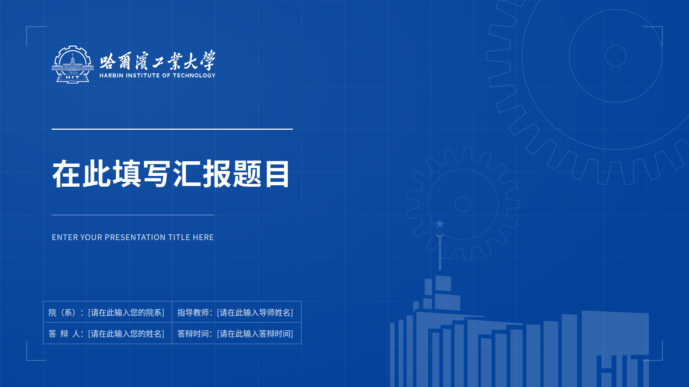
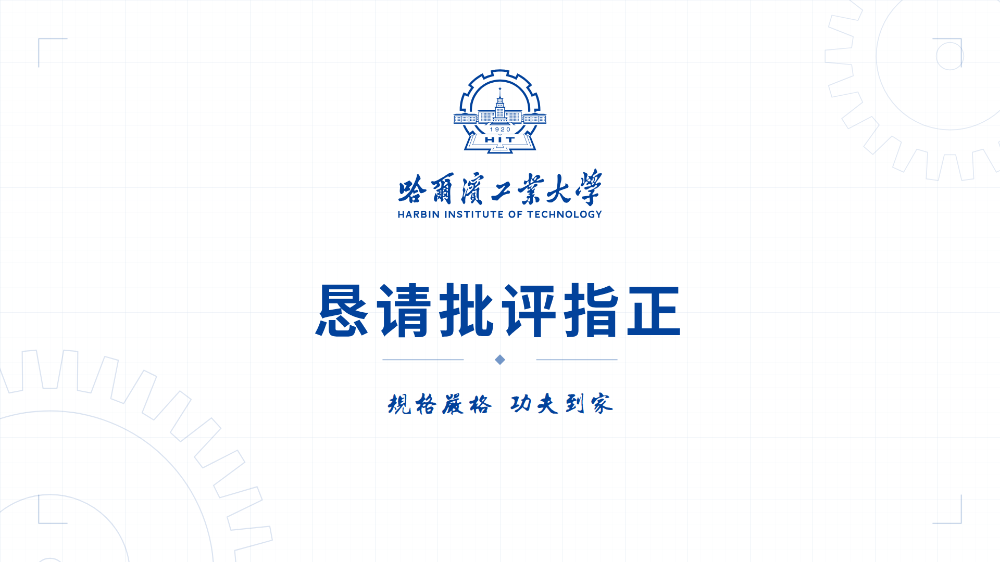
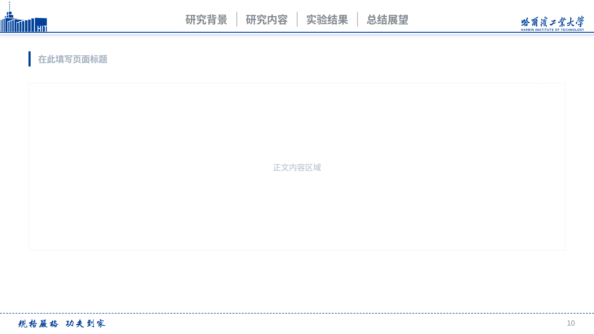
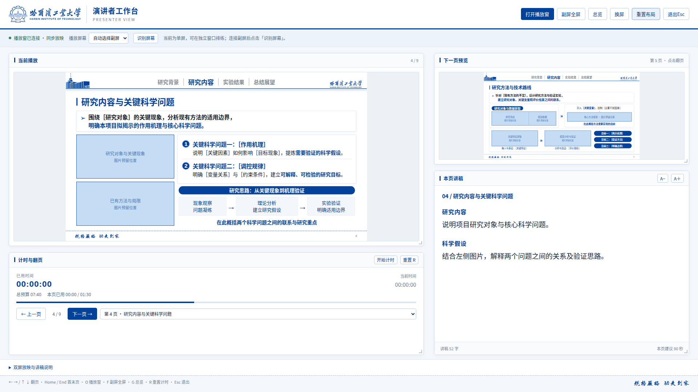
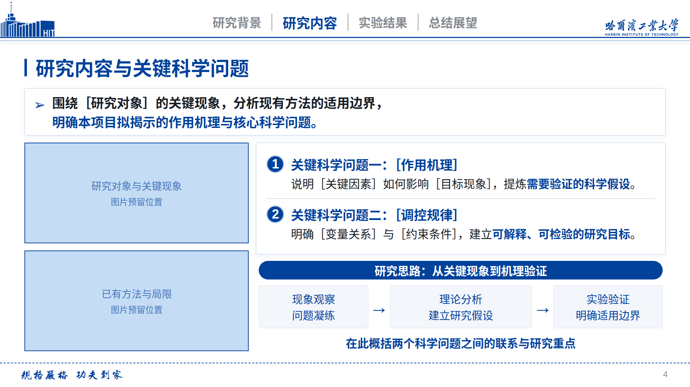
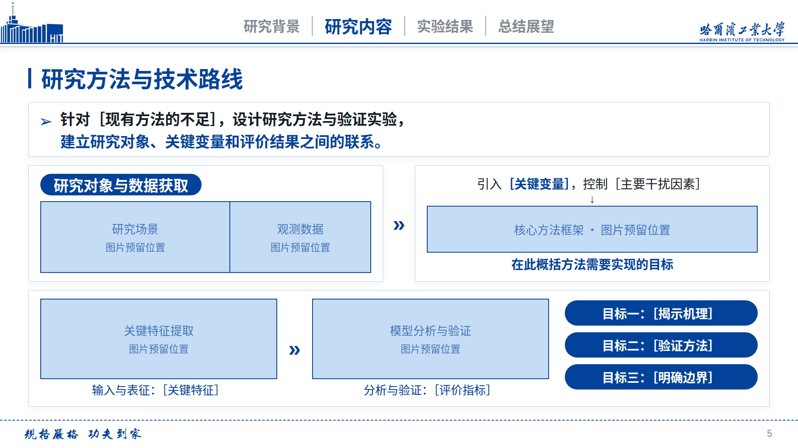

# HIT-PowerPoint-html

**哈尔滨工业大学学术汇报 HTML 模板**

[在线预览](https://dsqsqblxhq.github.io/HIT-PowerPoint-html/HIT-HTML.html) · [下载 HTML](https://github.com/DSQsqblxhq/HIT-PowerPoint-html/releases/download/v1.3/HIT-HTML.html) · [下载 Windows 双屏 CMD](https://github.com/DSQsqblxhq/HIT-PowerPoint-html/releases/download/v1.3/HIT-HTML-local.cmd)

本项目为个人整理，非哈尔滨工业大学官方发布。

## 预览

<table>
  <tr>
    <td align="center">
      
       
      封面页
    </td>
    <td align="center">
      
       
      结尾页
    </td>
  </tr>
  <tr>
    <td align="center">
      
       
      母版页
    </td>
    <td align="center">
      
       
      演讲者工作台
    </td>
  </tr>
  <tr>
    <td align="center">
      
       
      科学问题内容页
    </td>
    <td align="center">
      
       
      技术路线内容页
    </td>
  </tr>
</table>

## 主要功能

| 功能 | 说明 |
| --- | --- |
| HIT 风格模板 | 16:9 自适应缩放，含封面、目录、5 种基金答辩内容页、结尾和空白母版 |
| 基金答辩内容页 | 科学问题、技术路线、研究证据、申请人信息、科研条件保障；申请人页作为研究背景页，蓝框为图片预留位置，沿用默认字体 |
| 单文件离线放映 | 样式、脚本与 SVG 资源内嵌，支持键盘、鼠标和触屏操作 |
| 全屏与双屏 | 网页副屏自动全屏、同步翻页、选择播放屏幕与换屏 |
| 总览与导航 | 幻灯片缩略图跳转、章节导航 |
| 演讲者工作台 | 当前页与下一页预览、逐页讲稿、全程与本页计时、字号及布局调整 |
| 打印导出 | 浏览器打印或另存为 PDF |

## 快速开始

- **直接放映**：下载 [HIT-HTML.html](https://github.com/DSQsqblxhq/HIT-PowerPoint-html/releases/download/v1.3/HIT-HTML.html)，用浏览器打开。
- **Windows 本地自动双屏**：下载并双击 [HIT-HTML-local.cmd](https://github.com/DSQsqblxhq/HIT-PowerPoint-html/releases/download/v1.3/HIT-HTML-local.cmd)，使用新版 Edge / Chrome；只需这一个文件，无需联网、Python 或管理员权限。

双屏使用时，将系统显示设为“扩展”，使用新版 Edge / Chrome，点击“演讲”并允许屏幕管理和弹窗。在线版与 CMD 模式均可让观众画面在副屏自动全屏，工作台在原屏幕窗口显示。CMD 的终端和首页跟随启动屏幕，首页使用带地址栏和标签栏的普通浏览器窗口；演示期间保持终端打开，结束时在终端按 `Q` 或 `Esc`（无需回车），同时关闭放映窗口和本地服务。

常用快捷键：`←` / `→` 翻页，空格下一页，`F` 全屏，`G` 总览，`S` 演讲。鼠标移至页面底部可显示控制栏。

## 修改模板

用文本编辑器修改标题、正文和封面信息；`CONFIG.sections` 设置章节导航，`NOTES` 设置逐页讲稿和建议时长。保存后刷新浏览器；增删页面时同步调整章节页码和讲稿顺序。

详细操作、CMD 编辑方法及完整快捷键见 [使用指南](docs/USAGE.md)。

## 来源与许可

- 模板参考：[yhao-z/HIT-PowerPoint](https://github.com/yhao-z/HIT-PowerPoint)。
- 演讲者模式参考：[lewislulu/html-ppt-skill](https://github.com/lewislulu/html-ppt-skill)（作者 lewis，[MIT](licenses/html-ppt-skill-MIT.txt)）。
- 页签组件参考：Open Design `fs-notebook-tabs`（[MIT](licenses/open-design-fs-notebook-tabs-MIT.txt)）。

本仓库代码采用 [MIT](LICENSE)；PPT 设计、学校标识及字形等素材的来源、署名与使用范围见 [来源与第三方说明](docs/THIRD_PARTY_NOTICES.md)。
